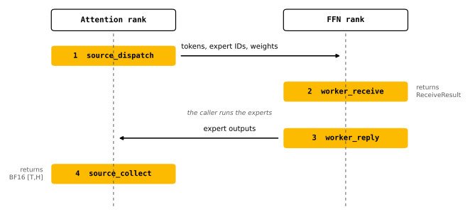
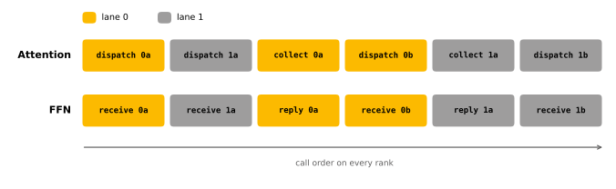

# API contract

A `Buffer` carries tokens from Attention ranks to FFN ranks and brings the results
back. `Buffer(group=..., config=Config(...))` owns one NCCL communicator and one
vendored DeepEP V2 ElasticBuffer. Before constructing it, the caller:

- creates a CPU **Gloo** process group and keeps it alive until `close()`;
- sets the current CUDA device.

Construction and `close()` are collective (every rank of the group calls them)
and run outside CUDA graph capture.

## Public API

`afdep` exports five names:

| Name | Purpose |
|---|---|
| `Config` | Layout and transport settings, identical on every rank |
| `Buffer` | One exchange at a time between the Attention and FFN ranks of one group |
| `Lanes` | Several Buffers on one group, for overlapping exchanges |
| `ReceiveResult` | What `worker_receive` returns: rows, weights, row ranges per expert and the receipt |
| `DispatchHandle` | Receipt of one dispatch, returned unchanged to `worker_reply` |

One exchange is four `Buffer` calls. Attention calls 1 and 4, FFN calls 2 and 3:

<picture>
  <source media="(prefers-color-scheme: dark)" srcset="assets/api-calls-dark.svg">
  
</picture>

`Buffer.role` (`"ffn"` or `"attention"`) tells a rank which pair to call, and
`Buffer.close()` ends the Buffer.

## Ranks and experts

FFN ranks come first and Attention ranks follow. FFN rank j owns the experts
`[j * E, (j + 1) * E)`, where `E = num_experts / ffn_ranks`. `Buffer.role_rank`
(`Config.role_rank`) is a rank's index within its role.

With `Config(ffn_ranks_per_domain=f)` the FFN ranks are instead the first `f` ranks
of every NVLink domain, so every node can hold FFN ranks. With `U` ranks per domain,
FFN index j is rank `(j // f) * U + j % f` (`Config.ffn_rank`) and owns the same
experts as above. The physical domains must match this layout: `ffn_ranks / f`
domains of `U = world_size * f / ffn_ranks` ranks each, with hybrid mode on or off
(direct RDMA).

`Config` rejects a layout unless `hidden_size` is a multiple of 256,
`top_k ≤ min(32, num_experts)`, and `num_experts` divides evenly over the FFN ranks.

## Buffer calls

Rules for every exchange:

- Every rank uses the same `Config`, the same order of exchanges, and the same
  `bucket` and `read_host_counts` in each exchange.
- A Buffer allows one unmatched dispatch: collect it before the next dispatch.
- All payload tensors are on the selected CUDA device.
- The library does not quantize or run GEMMs, except the opt-in lossy reply
  transport `AFDEP_HYBRID_FP8_COMBINE` below.

Below, `T` is the number of tokens one Attention rank sends, `H` is `hidden_size`
and `K` is `top_k`.

### 1. `source_dispatch` (Attention)

`source_dispatch(x, ids, weights, x_scale=None, *, bucket, read_host_counts=False)`
sends `T` tokens to their experts.

| Argument | Shape | Type | Meaning |
|---|---|---|---|
| `x` | `[T, H]` | BF16, or `float8_e4m3fn` with `payload="fp8"` | Activations |
| `ids` | `[T, K]` | `buffer.topk_idx_dtype` | Experts of each token: unique per token, in `[0, num_experts)`, or `-1` to skip |
| `weights` | `[T, K]` | FP32 | Routing weight of each expert in `ids` |
| `x_scale` | `[T, H / 128]` | FP32 | FP8 only: one scale per block of 128 values |
| `bucket` | integer | | Upper bound on `T`: `T ≤ bucket ≤ capacity_tokens_per_rank` |

`x`, `ids` and `weights` must be contiguous; `x_scale` may be a strided view.
Invalid IDs assert on the GPU, including on graph replay.

### 2. `worker_receive` (FFN)

`worker_receive(*, bucket, read_host_counts=False)` returns a `ReceiveResult`:

| Field | Content |
|---|---|
| `recv_x` | Received rows, grouped by expert |
| `recv_scale` | FP8 scales of the rows; `None` for BF16 |
| `recv_topk_weights` | Routing weight of each row |
| `recv_count_psum` | Device tensor `ends`: the row where each expert's rows end |
| `recv_counts_host` | With `read_host_counts=True`: **aligned** per-expert counts, not raw live counts |
| `receipt` | `DispatchHandle` to pass unchanged to the matching `worker_reply` |

Expert e occupies rows `[align_up(ends[e-1], expert_alignment), ends[e])`, with
`ends[-1] = 0` for e=0. The rows in between are padding: their content is
unspecified and they must not be treated as live tokens.

### 3. `worker_reply` (FFN)

`worker_reply(rows, receipt)` sends the expert outputs back. `rows` is contiguous
BF16 with the entire shape of `recv_x`, each expert's rows in place. The caller
multiplies each row by its routing weight exactly once.

### 4. `source_collect` (Attention)

`source_collect(*, view=False)` returns BF16 `[T, H]`: for each token, the sum over
its selected experts, in the original token order. `view=True` is described under
[Registered buffers](#registered-buffers).

## Graphs, streams and lifetime

### CUDA graphs

- Warm up the kernels on all ranks, then capture **complete** dispatch/reply pairs
  with `read_host_counts=False`.
- Keep the captured tensors, the Buffer and the graph storage alive through every replay.
- Source tensor shapes and `bucket` specialize the capture. Change payloads and IDs
  in place; encode inactive choices as `-1`.
- This is capacity-bounded graph execution, not arbitrary-shape graph replay.
- Graph capture/instantiation and replay are different operations; replay still
  has a launch cost.

### Receive size

`read_host_counts=True` performs host synchronization for exact eager receive
allocation on FFN. Otherwise receive capacity is conservative and device counts
identify live rows. Attention has zero receive payload rows. FFN bounds count
Attention sources only.

### Registered buffers

Registered transport buffers are distinct from receive tensors, except for
`source_collect(view=True)`:

- With one FFN rank in one NVLink domain (and no more ranks than top-k), each
  token's only reply row is already its final output. The call then skips the
  reduce kernel and returns a strided `[T, H]` view of the registered combine inbox.
- Treat the view as read-only. It is valid until the next `source_dispatch` on the
  same Buffer is enqueued; copy it if the caller needs it longer.
- Other layouts return the ordinary result.

In one NVLink domain registered buffers are sized by role: FFN dispatch inboxes for
the Attention sources and, when ranks do not exceed top-k, Attention combine inboxes
for the FFN ranks; every rank registers the same size. `AFDEP_UNION_BUFFERS=1` keeps
DeepEP's symmetric sizing, for comparison in measurements.

### Streams and lifetime

- Operations order their internal communication stream with the current CUDA
  stream using DeepEP events. Use caller stream dependencies before passing data
  produced on another stream.
- Outputs, receipts and user inputs must remain alive until dependent GPU work
  completes.
- A completed Python pair allows the next pair to be enqueued; device-side protocol
  and stream ordering protect reuse.
- Independent Buffers do not share ordering.
- `close()` synchronizes outstanding work and frees registered storage; destroy
  graphs before closing the Buffer.

## Several Buffers on one group

A Buffer holds one exchange at a time. To keep several in flight, as dual-batch
overlap (DBO) does with one exchange per micro-batch, use `Lanes`:

```python
lanes = Lanes(group=group, config=config, lanes=2)  # collective, outside capture
lanes[0].source_dispatch(...)  # each lane is an ordinary Buffer
lanes.close()
```

Each lane owns its communicator, registered storage, pending receipt and
communication stream, so memory grows with the number of lanes. `Lanes` checks
that every rank asks for the same number and that no two lanes share a stream.
A caller that constructs the Buffers itself must set
`AFD_DEEPEP_PER_BUFFER_COMM_STREAM=1` (`afdep.deepep.PER_BUFFER_COMM_STREAM_ENV`)
on every rank before the first one; `Lanes` sets it only while it constructs and
then restores it. The guarantees below hold with separate streams.

What an integration can rely on:

- **Calls enqueue and return.** With `read_host_counts=False` every operation
  enqueues GPU work ordered after the caller's current stream and returns without
  waiting for peers. Run each lane's calls on whichever caller stream holds its data.
- **One lane runs in call order.** Dispatch, reply and the next dispatch on one Buffer
  execute in the order they were called, on every rank.
- **Lanes are independent.** No operation on one Buffer waits for another Buffer.
  The caller orders lanes and adds stream dependencies when one lane's output
  feeds another.

Every rank must still make the same calls on the same lane in the same order.
With two lanes and layers a, b, ...:

<picture>
  <source media="(prefers-color-scheme: dark)" srcset="assets/api-lanes-dark.svg">
  
</picture>

Mapping micro-batches to lanes and choosing this order belong to the caller. The
GPU suite runs this order eagerly on per-lane streams and as one captured graph
(`--lanes 2`).

## Transport and tuning

### The layer underneath

afdEP-comm keeps DeepEP's uniform logical expert numbering (Attention ranks own empty
expert blocks, never legal routing targets) and its collective participation.
Underneath `Buffer` is `afdep.deepep.ElasticBuffer`, which takes DeepEP's logical expert
numbering and the caller's own empty and zero tensors:

- `ffn_ranks=M` selects afdEP-comm's transport, as `Buffer` does from `Config`.
- `ffn_ranks_per_domain=f` adds a per-domain FFN prefix. Its dispatch takes real expert
  IDs and maps them to the logical numbering itself (the FFN blocks are no longer
  `[0, F·E)`).
- Without `ffn_ranks` it runs DeepEP V2 as upstream ships it, over a symmetric group.
  The benchmarks use that for the baseline, FastAFD's DeepEP M2N
  ([benchmarks/fastafd.py](../benchmarks/fastafd.py)).

### Tuning and hybrid modes

`allow_hybrid_mode`, `num_sms`, `num_qps`, timeouts and RDMA traffic class pass
through to the pinned transport. `num_sms=0` selects approximately 24/132 of the
smallest device's SM count; choose/tune explicitly for a workload. Both hybrid
settings are validated in one NVLink domain and across NVLink domains joined by GIN.

Across domains, the layout selects the hybrid ([design](design.md), sections 6 and 7):

| Layout | Hybrid |
|---|---|
| Every domain holds one role | Directional hybrid. It always signals only the channels that carry tokens (the sparse directional hybrid, section 17 and [sparse-hybrid.md](sparse-hybrid.md)); there is nothing to set |
| Domains mix roles | Union hybrid |
| Per-domain FFN prefix (both roles in every domain) | The union hybrid's work with per-rank roles, silent FFN rails and Attention rails without the dispatch-entry barrier (section 20) |

The opt-in `AFDEP_MIXED_HYBRID` (section 18) changes the protocol when FFN ranks share
a domain with Attention ranks. Set it, `AFDEP_UNION_HYBRID` and any `AFDEP_SHARED_*`
ablation setting alike on every rank before constructing the `Buffer` and keep them;
construction gathers every rank's resolved values once and rejects a mismatch.

### FP8 replies

`AFDEP_HYBRID_FP8_COMBINE=1` (section 19; validated on H200; GSM8K accuracy unchanged,
no per-layer or next-token KL check yet) sends the directional hybrid's combine replies
across NVLink domains as FP8. It is off outside the directional hybrid.

- **Setting.** Set it alike on every rank before construction, which latches it (later
  changes have no effect), checks it on every rank and reports it as `Buffer.fp8_combine`.
- **Loss.** Each FFN domain's BF16 partial is rounded to E4M3 with a power-of-two scale
  per 128 elements before the source sums the domains in FP32. The error is at most 2^-4
  of the group's largest magnitude; tiny elements flush to zero; NaN stays in place; an
  infinity zeroes its group's finite elements unless they are near the BF16 range limit.
  `source_collect` still returns BF16.
- **Small buckets.** `AFDEP_HYBRID_FP8_COMBINE_MIN_BUCKET=b` keeps BF16 replies for
  exchanges whose bucket is below b tokens (every rank passes the same bucket, so both
  roles agree on the row format). It is latched and checked with the setting above and
  reported as `Buffer.fp8_combine_min_bucket`. The default 0 means every bucket,
  negative values clamp to 0, and it reports 0 when FP8 is off.

### Build and caches

Native compilation is lazy and process-locked. `AFDEP_CACHE_DIR` controls the
extension cache; `EP_JIT_CACHE_DIR` controls DeepEP kernel JIT cache. Both must be
writable. Use matching NCCL headers/runtime before starting Python; already
loaded libraries cannot be replaced by changing environment variables later.
